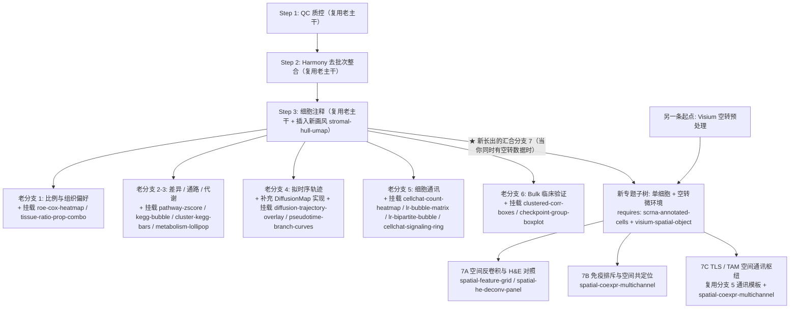

# Research Wiki v5 顶层产品架构设计书：底层去重积木网（DAG）+ 可组合思路分支树 + 统一多风格模板

> **日期**：2026-11-19  
> **状态**：作者确认通过（基于 Cai et al., *npj Precision Oncology* 2026 复刻复盘与产品经理架构评审）  
> **关联实施计划**：[plan-dag-tree-unified-templates-v5.md](../../archive/plan-dag-tree-unified-templates-v5.md)（已执行归档）

---

## 一、背景与需求复盘（多轮产品讨论核心共识）

在完成 Cai et al. (2026) 全套 12 张计算图（Main Fig. 1–6［剔除湿实验 3F–H］+ Supp Fig. 1–6）1:1 复刻入库后，围绕“如何长期积累而不混乱、不重复、不自相矛盾”，我们逐一对齐并确认了以下 **6 项顶层决策**：

1. **渐进彻底消除“L1 配方 vs L2 模板”矛盾**：
   - 保留 `wiki/recipes/` 下 146 个历史只读文件不硬删以免断链，后续分批平滑迁入 `wiki/templates/`；
   - 从 `wiki/AGENTS.md`、所有技能文档（`paper-replication` / `research-wiki`）及前端 14 个展示文件彻底取消 L1/L2 与“配方”割裂文案，对外与新建一律统称 **「绘图模板」**（历史归档称「历史归档模板」）。
2. **一类图允许多套顶刊风格模板并存、真实课题一键切换**：
   - `check-dup` 只拦截“代码/样式完全冗余的克隆”，绝不阻挡“同一分析方法下的不同期刊画风变体”；
   - 每个模板强制标注两项产品元信息，彻底避免复刻 30 篇后出现“选择瘫痪”：
     - **`style_tier`**：`default`（每个方法下 1 个主推默认风格）或 `variant`（高阶/特定期刊可切换画风变体）+ `journal_style`（来源风格标记）；
     - **数据兼容性**：在方法页 `figure_relations` 中显式标注 `direct`（直接喂表）或 `adaptable`（需整理/转置列并写明 `adaptation`）。
3. **作者原版源码 vs 可复用模板分离存储**：
   - 作者原版脚本（如 Cai 2026 的 8 份 GitHub R 脚本）只读保存在论文专属档案的 `source/` 目录（配 `source-manifest.json` 记 commit 与 sha256），作为科学溯源底稿；
   - 改写后的分步分析与整图拼图脚本存 `code/`；
   - 拆解出的可换数据单 Panel 代码统一存入 `wiki/templates/<short-slug>/`。
4. **为什么不能用“纯分支树（Tree）”存底层，而必须解耦为「底层 DAG + 表层分支树」**：
   - **纯树死结 ①（无法多上游汇合）**：如空间反卷积（RCTD）必须同时吃「单细胞注释结果」+「Visium 空转数据」，Cox 预后必须同时吃「单细胞 Marker」+「TCGA Bulk 临床表」；纯树单父节点要么找不到、要么重复存。
   - **纯树死结 ②（下游复制粘贴爆炸）**：单细胞、空转、Bulk 三条上游都要接 DEG → 富集 → 免疫相关性 → 预后，纯树会把下游复制多份。
   - **纯树死结 ③（节点挂满画风引发选择瘫痪）**：必须用 `default` / `variant` 分层收纳。
   - **纯树死结 ④（论文案例散落三张皮）**：论文个案与通用方法、通用模板必须边界清晰，做到**通用回流、特例隔离**。
5. **四支柱解耦架构（面向小白零心智负担）**：
   - **① 方法积木库（`wiki/methods/`，26 个规范 `analysis` 家族）**：只放通用分析方法，绝不重复建方法；同一方法的不同工具（如 Harmony vs scVI、Monocle3 vs DiffusionMap/Slingshot）统一作为 `implementations` 算法开关挂载；通过 `figure_relations` 与 `next_steps` 显式连接多套可切换模板。
   - **② 绘图模板库（`wiki/templates/`）**：所有可换数据绘图代码统称模板，按 `primary_method` + `style_tier (default|variant)` + `journal_style` 组织。
   - **③ 思路分支树（`wiki/scenarios/`）**：不存代码，只存**「决策路口（`when:`）+ 指针（`method_id`/`templates`）+ 多上游汇合声明（`requires: [...]`）」**；维护多棵高频专题树，底层允许 DAG 汇合，前端按用户起点展开为清爽步进树。
   - **④ 论文复刻案例（`wiki/projects/` + `gallery/` + `methods/<workflow>`）**：每篇完整复刻文献沉淀 1 张走线实录卡（记录沿着分支树具体拐的弯、作者原版 `source/`、整图拼图 `code/`、1:1 画廊对比图、湿实验排除与降维边界），绝不把特定疾病基因或小规模妥协污染进通用方法页。
6. **每篇新文献复刻后的固定复利动作（「三查一记」）**：
   - **一查主干与老分支**：已有方法直接复用，新算法塞进 `implementations`；
   - **二查模板库**：新画风挂回对应方法下当 `variant`（或补齐空白成为 `default`）；
   - **三查是否需要新专题子树**：仅当引入新组学/新多上游汇合路线时，长出新专题子树并写明 `requires`；
   - **四记独立案例走线卡**：完整归档论文研究故事、作者原版底稿与 1:1 整图对比。

---

## 二、具体接入示范：Cai et al. (2026) 如何丝滑接入既有 `QC → 去批次 → 注释` 分支树

以仓库既有主干树 `wiki/scenarios/scrna-stepwise-playbook.md` 为例，接入 Cai 2026 时**零复制老代码**：

- **动作 ① 复用老主干（Step 1→2→3）**：不重写主干，只在 Step 3 注释下新增 `stromal-hull-umap`（`variant`）与默认 `scrna-celltype-umap`（`default`）并列切换。
- **动作 ② 增强老分支 1～6**：把 19 套 Cai 2026 原生模板按语义挂回对应老分支及 11 个规范方法页的 `figure_relations`，使每个节点具备多画风可切换能力。
- **动作 ③ 嫁接汇合型分支 7（`stromal-tme-scrna-st-playbook`）**：在老树 Step 3 后挂入 `branch-7-stromal-spatial-tme`，声明 `requires: [scrna-annotated-cells, visium-spatial-object]`；纯单细胞课题不受干扰，一旦手头有空转数据即可直接沿子树推进。
- **动作 ④ 独立落盘案例走线卡（`projects/2026-cai-stromal-tme.md`）**：完整记录乳腺癌 23 万基质细胞 → `C10_lpFib_ABCA8` 排斥耗竭 CD8⁺ T → `C8_iFib_CCL19` 聚拢 TLS & `C4_TipEC_PGF` 招募 TAM/M2 的 6 阶段走线，外挂作者原版 `source/`、12 图拼图 `code/`、1:1 画廊对比图与湿实验排除边界（Fig. 3F–H）。

---

## 三、全仓基线审查结论（2026-11-19 实测）

1. **`wiki/methods/`（55 页）**：含 26 个规范 `analysis` 方法、7 个 `workflow`、22 个 `technical`；11 个核心分析方法待补齐 `figure_relations` 与 `next_steps`。
2. **`wiki/templates/`（94 已提交 + 9 半成品）**：已提交 9 个 Cai 2026 模板，磁盘另存 9 个半成品新模板（缺 `verify/figure.png` 及 `style_tier`），再补 1 个 `stromal-hull-umap` 共形成 **19 套 Cai 2026 原生模板**（实现全篇 12 张图 100% 面板覆盖）。
3. **矛盾文案分布**：`wiki/AGENTS.md`（43 处）、11 篇 `scenarios/`（248 处）、`开发/skills/`（143 处）与 `开发/apps/web/src/`（14 个文件 35 处）仍混用 L1/L2 与“配方/模板”提法，需按本计划书统一收口。
4. **前端支持度**：`PlaybooksView.tsx` 已有 4 棵交互式 SVG DAG 决策树，可直接注册第 5 棵 `stromal-tme-scrna-st-playbook` 与 `requires` 多上游汇合标识。
